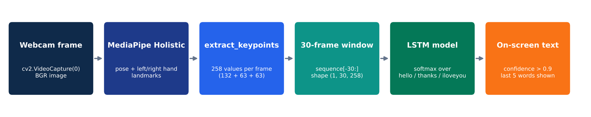
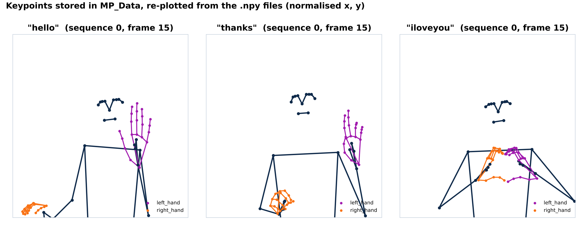
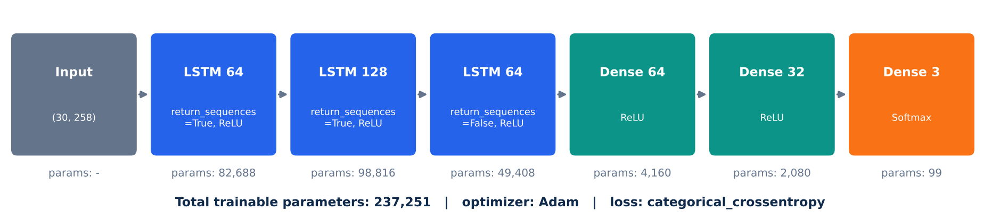
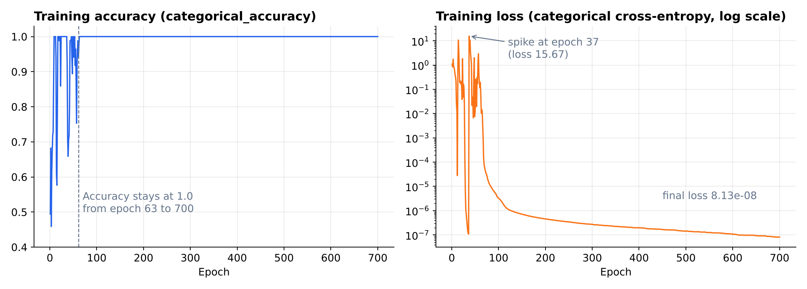
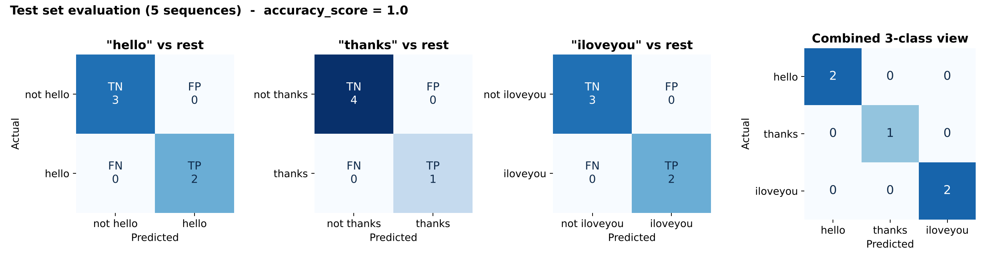

<div align="center">

# 🤟 SignSense

### Real-Time Sign Language Recognition using MediaPipe Holistic and LSTM

Recognises the signs **hello**, **thanks** and **I love you** live from a webcam and writes them on screen as text.


-success)

</div>

---

## 📑 Table of contents

1. [About the project](#-about-the-project)
2. [Team 16](#-team-16)
3. [Repository contents (assignment checklist)](#-repository-contents-assignment-checklist)
4. [How it works](#-how-it-works)
5. [Dataset](#-dataset)
6. [Model](#-model)
7. [Results](#-results)
8. [How to run – step by step](#-how-to-run--step-by-step)
9. [Troubleshooting](#-troubleshooting)
10. [Limitations and future work](#-limitations-and-future-work)
11. [Tech stack](#-tech-stack)

---

## 📖 About the project

People who communicate in sign language often face a barrier when the person they are talking to does not know it. **SignSense** is a small step towards bridging that gap: it watches a person through an ordinary webcam, follows the movement of their body and hands, and translates the signed gesture into an English word in real time.

Instead of feeding raw video pixels to a neural network, SignSense first uses **Google MediaPipe Holistic** to locate **75 body and hand landmarks** in every frame (33 pose + 21 per hand). These landmark coordinates are turned into a compact **258-number feature vector** per frame. A **stacked LSTM network** then looks at **30 consecutive frames** – i.e. the *motion* of the sign – and classifies it as one of three signs:

| Sign | Label in code |
|---|---|
| 👋 Hello | `hello` |
| 🙏 Thank you | `thanks` |
| 🤟 I love you | `iloveyou` |

Everything – data collection, training, evaluation and the live demo – lives in a single Jupyter notebook: [`AIProjectSe4.ipynb`](AIProjectSe4.ipynb).

---

## 👥 Team 16

| # | Name | Roll No. |
|---|---|---|
| 1 | Soham Bacchuwar | 20233571 |
| 2 | Sri Ram Varun Dittakavi | 20233574 |
| 3 | Shubham Daya Vadher | 20233568 |
| 4 | Varun Kumar | 20233581 |

---

## ✅ Repository contents (assignment checklist)

| Requirement | Where to find it |
|---|---|
| 1. Source code | [`AIProjectSe4.ipynb`](AIProjectSe4.ipynb) – complete pipeline (11 sections) |
| 2. Dataset | [`MP_Data/`](MP_Data) – 90 recorded sign sequences (2,700 `.npy` keypoint files) |
| 3. Implementation details | [`docs/IMPLEMENTATION.md`](docs/IMPLEMENTATION.md) + [How it works](#-how-it-works) below |
| 4. Step-by-step run instructions | [How to run – step by step](#-how-to-run--step-by-step) below |
| 5. PPT presentation | [`docs/SignSense_Presentation.pptx`](docs/SignSense_Presentation.pptx) |
| 6. Final project report | [`docs/SignSense_Project_Report.pdf`](docs/SignSense_Project_Report.pdf) (editable: [`.docx`](docs/SignSense_Project_Report.docx)) |

```
TEAM_16/
├── AIProjectSe4.ipynb          # Source code – the full project notebook
├── action.keras                # Trained LSTM model (saved by the notebook)
├── MP_Data/                    # Dataset: keypoint sequences
│   ├── hello/     0 … 29/      #   30 sequences × 30 frames (0.npy … 29.npy)
│   ├── thanks/    0 … 29/
│   └── iloveyou/  0 … 29/
├── Logs/train/                 # TensorBoard event files written during training
├── docs/
│   ├── IMPLEMENTATION.md       # Detailed implementation notes
│   ├── SignSense_Presentation.pptx
│   ├── SignSense_Project_Report.pdf
│   └── SignSense_Project_Report.docx
├── assets/                     # Figures used in this README, the report and the slides
├── requirements.txt            # Python dependencies (exact versions used)
└── README.md
```

---

## ⚙️ How it works



1. **Capture** – OpenCV reads frames from the default webcam (`cv2.VideoCapture(0)`).
2. **Detect landmarks** – each frame is converted from BGR to RGB and passed through **MediaPipe Holistic** (`min_detection_confidence=0.5`, `min_tracking_confidence=0.5`), which returns pose, face, left-hand and right-hand landmarks. Pose and hand landmarks are drawn on the frame.
3. **Extract keypoints** – `extract_keypoints()` flattens the landmarks of one frame into a vector of **258 values**:

   | Part | Landmarks | Values per landmark | Total |
   |---|---|---|---|
   | Pose | 33 | x, y, z, visibility | 132 |
   | Left hand | 21 | x, y, z | 63 |
   | Right hand | 21 | x, y, z | 63 |
   | **Frame vector** | | | **258** |

   If a body part is not visible, its slot is filled with zeros so the vector length never changes. Face landmarks (468 × 3 = 1,404 values) are computed in Section 3 for exploration but are **left out** of `extract_keypoints()` (the line is commented out), keeping the input small.
4. **Build a sequence** – the 30 most recent frame vectors are kept (`sequence[-30:]`), giving an input of shape **(1, 30, 258)**.
5. **Classify** – the LSTM model outputs a probability for each of the three signs (softmax).
6. **Display** – if the highest probability is above **0.9** and the word differs from the last word shown, it is appended to the on-screen sentence. Only the last **5** words are kept and drawn in a banner at the top of the video window.

A full, cell-by-cell explanation is in [`docs/IMPLEMENTATION.md`](docs/IMPLEMENTATION.md).

---

## 🗂 Dataset

The dataset was **recorded by the team** with the notebook's data-collection cell (Section 5) and is stored in [`MP_Data/`](MP_Data). It contains **keypoints, not video** – every file is one frame's 258-value vector saved with `np.save`.

| Property | Value |
|---|---|
| Signs (classes) | 3 – `hello`, `thanks`, `iloveyou` |
| Sequences per sign | 30 (folders `0` … `29`) |
| Frames per sequence | 30 (files `0.npy` … `29.npy`) |
| Values per frame | 258 (`float64`) |
| Total sequences | 90 |
| Total `.npy` files | 2,700 |
| Array shape after loading | `X`: (90, 30, 258) · `y`: (90, 3) one-hot |

Path pattern: `MP_Data/<sign>/<sequence>/<frame>.npy`, e.g. `MP_Data/thanks/12/7.npy`.



How often each body part was detected across the 900 frames of each sign:

| Sign | Pose | Left-hand block | Right-hand block |
|---|---|---|---|
| hello | 100 % | 99.9 % | 1.6 % |
| thanks | 100 % | 100 % | 99.8 % |
| iloveyou | 100 % | 100 % | 100 % |

So *hello* is essentially a one-hand sign in this data, while *thanks* and *I love you* use both hand blocks.

---

## 🧠 Model



```python
model = Sequential()
model.add(LSTM(64, return_sequences=True, activation='relu', input_shape=(30, 258)))
model.add(LSTM(128, return_sequences=True, activation='relu'))
model.add(LSTM(64, return_sequences=False, activation='relu'))
model.add(Dense(64, activation='relu'))
model.add(Dense(32, activation='relu'))
model.add(Dense(actions.shape[0], activation='softmax'))
model.compile(optimizer='Adam', loss='categorical_crossentropy', metrics=['categorical_accuracy'])
```

| Layer | Output shape | Parameters |
|---|---|---|
| LSTM (64, return_sequences=True) | (30, 64) | 82,688 |
| LSTM (128, return_sequences=True) | (30, 128) | 98,816 |
| LSTM (64, return_sequences=False) | (64) | 49,408 |
| Dense (64, ReLU) | (64) | 4,160 |
| Dense (32, ReLU) | (32) | 2,080 |
| Dense (3, Softmax) | (3) | 99 |
| **Total trainable** | | **237,251** |

- The first two LSTM layers return the whole sequence so the next LSTM can keep learning across time; the third returns only its final state, a summary of the whole 30-frame movement.
- The dense layers turn that summary into class scores; softmax converts them into probabilities.
- **Training setup:** 95 % / 5 % train–test split (`train_test_split(test_size=0.05)`) → **85 training** and **5 test** sequences; Adam optimiser; categorical cross-entropy loss; **700 epochs**; default batch size 32 (3 steps per epoch); TensorBoard callback writing to `Logs/`.
- The trained model is saved as [`action.keras`](action.keras).

---

## 📊 Results

### Training



*Plotted from the training log printed in the notebook (Section 7).*

- Training accuracy first reached **100 % at epoch 9**.
- Between epochs 13 and 62 the loss spiked several times (largest: **15.67 at epoch 37**) before settling.
- From **epoch 63 to 700** training accuracy stayed at **100 %**, and the final loss was **8.13 × 10⁻⁸**.

### Evaluation on the test set



The notebook evaluates the model on the 5 held-out sequences (2 × hello, 1 × thanks, 2 × iloveyou) with `multilabel_confusion_matrix` and `accuracy_score`:

| Sign | TP | TN | FP | FN |
|---|---|---|---|---|
| hello | 2 | 3 | 0 | 0 |
| thanks | 1 | 4 | 0 | 0 |
| iloveyou | 2 | 3 | 0 | 0 |

**Accuracy = 1.0 (5 / 5 correct).**

### Real-time test

In the live webcam test (Section 11) the notebook's printed output shows the model following the signer as they switch signs, with predictions moving through **hello → thanks → iloveyou → thanks → hello → thanks**, each held steadily over many consecutive frames. Most predictions took about 15–40 ms each on the team's laptop.

---

## 🚀 How to run – step by step

> **You need:** a computer with a **webcam**, **Python 3.11** (the project was built with 3.11.8 on Windows) and about 2 GB of free disk space for the libraries.
> TensorFlow 2.15 does **not** support Python 3.12+, so please use 3.11.

### Step 1 – Get the code

```bash
git clone https://github.com/soham200521/TEAM_16.git
cd TEAM_16
```
(or click **Code → Download ZIP** on GitHub and extract it).

### Step 2 – Create a virtual environment (recommended)

```bash
# Windows
py -3.11 -m venv venv
venv\Scripts\activate

# macOS / Linux
python3.11 -m venv venv
source venv/bin/activate
```

### Step 3 – Install the libraries

```bash
pip install -r requirements.txt
```
(The first cell of the notebook, `%pip install ...`, does the same thing if you prefer to install from inside Jupyter.)

### Step 4 – Open the notebook

```bash
jupyter notebook AIProjectSe4.ipynb
```
VS Code with the Jupyter extension works too. Keep the notebook **in the repository root** – it uses the relative paths `MP_Data`, `Logs` and `action.keras`.

### Step 5 – Run the cells in order

| Notebook section | What it does | What to do |
|---|---|---|
| **1. Import and Install Dependencies** | Installs and imports OpenCV, NumPy, MediaPipe, Matplotlib | Run both cells |
| **2. Keypoints using MP Holistic** | Defines `mediapipe_detection()` and `draw_landmarks()`, then opens a webcam test window | Run all cells. A window **"OpenCV Feed"** opens with your skeleton drawn on it. Click the window and press **`q`** to close it |
| **3. Extract Keypoint Values** | Defines `extract_keypoints()` | Run both cells (the first one uses the last frame from the webcam test, so run Section 2 first) |
| **4. Setup Folders for Collection** | Sets `actions`, `no_sequences = 30`, `sequence_length = 30`; creates `MP_Data` folders | Run both cells – existing data is **not** touched |
| **5. Collect Keypoint Values** | Records new training data from the webcam | ⚠️ **Skip this cell** to use the dataset already in `MP_Data/`. Running it **overwrites** the existing `.npy` files with new recordings |
| **6. Preprocess Data** | Loads all 2,700 `.npy` files into `X` (90, 30, 258) and `y` (90, 3); splits 95 / 5 | Run all three cells |
| **7. Build and Train LSTM** | Builds the network and trains it for 700 epochs | Run all cells (training takes only a few minutes on a normal CPU) |
| **8. Make Predictions** | Converts class indexes back to sign names | Run (optional) |
| **9. Save Weights** | Saves the model to `action.keras` | Run – this **overwrites** the provided `action.keras` with your newly trained model |
| **10. Evaluation** | Confusion matrix and accuracy on the test split | Run both cells |
| **11. Test in Real Time** | Live sign recognition from the webcam | Run, then sign **hello**, **thanks** or **I love you** in front of the camera. Recognised words appear in the banner at the top. Press **`q`** to quit |

> 💡 **Note:** `train_test_split` is called without a fixed `random_state`, so each run picks a different 5-sequence test set and the exact numbers can vary slightly between runs.

#### Optional – use the provided trained model instead of re-training

If you want to go straight to the live demo without training, run Sections 1–4 and 6, run the model-building cells of Section 7 **except** `model.fit(...)`, then in a new cell run:

```python
from tensorflow.keras.models import load_model
model = load_model('action.keras')
```

and continue with Sections 10 and 11. (This only adds a scratch cell for your own run; the project notebook itself is unchanged.)

### Step 6 – Recording your own data (optional)

1. Run Sections 1–4.
2. Run Section 5. For each sign the notebook waits 5 seconds, then records **30 sequences × 30 frames**. At the start of every sequence the window shows **"STARTING COLLECTION"** and pauses 2 seconds – get into position and perform the sign during the following frames.
3. Continue from Section 6 to retrain on the new data.

### Step 7 – View training logs in TensorBoard (optional)

```bash
tensorboard --logdir Logs
```
Then open http://localhost:6006. The included `Logs/train` folder holds the event files from one of the team's training sessions; re-running Section 7 adds new event files.

---

## 🛠 Troubleshooting

| Problem | Fix |
|---|---|
| `AttributeError: module 'mediapipe' has no attribute 'solutions'` | Install the exact version: `pip install mediapipe==0.10.21` (the notebook uses the legacy `mp.solutions` API, which newer MediaPipe releases no longer include) |
| TensorFlow fails to install | Check `python --version` – it must be **3.11** (or 3.9–3.11) for TensorFlow 2.15 |
| Webcam window is black / `cv2.error ... !_src.empty()` | Another app is using the camera, or your camera isn't index `0`. Close other camera apps (Zoom, Teams, etc.) |
| The "OpenCV Feed" window won't close | Click the window first so it has focus, then press `q`. If it is still stuck, run the last notebook cell (`cap.release()` / `cv2.destroyAllWindows()`) |
| Signs are not being recognised | Stand so your upper body and both hands are visible, use good front lighting, and hold each sign for about a second (the model needs 30 frames) |
| `ValueError` about input shape | Make sure `extract_keypoints()` returns 258 values (face landmarks stay commented out) |

---

## 🔭 Limitations and future work

- **Vocabulary:** only 3 signs. More signs can be added by extending the `actions` array, recording data for them in Section 5 and retraining.
- **Data size:** 90 sequences recorded by the team. More signers, backgrounds and lighting conditions would make the model more robust.
- **Evaluation size:** the test split is 5 % (5 sequences). A larger test set or k-fold cross-validation would give a more reliable accuracy estimate.
- **Output:** recognised words are shown as text; text-to-speech could be added so the system can "speak" the sign.

---

## 🧰 Tech stack

| Tool | Used for |
|---|---|
| **Python 3.11** | Language |
| **OpenCV** | Webcam capture, drawing, display window |
| **MediaPipe Holistic** | Pose and hand landmark detection |
| **NumPy** | Keypoint arrays and `.npy` dataset storage |
| **scikit-learn** | Train/test split, confusion matrix, accuracy |
| **TensorFlow / Keras** | LSTM model, training, TensorBoard logging |
| **Matplotlib** | Imported in the notebook (plotting) |
| **Jupyter Notebook** | Development environment |

---

<div align="center">
Made by Soham Bacchuwar · Sri Ram Varun Dittakavi · Shubham Daya Vadher · Varun Kumar
</div>
